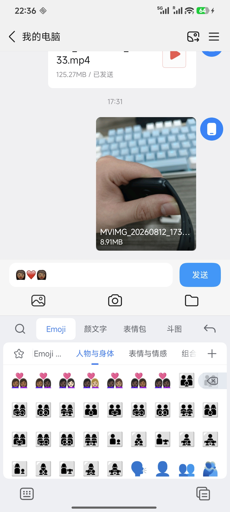
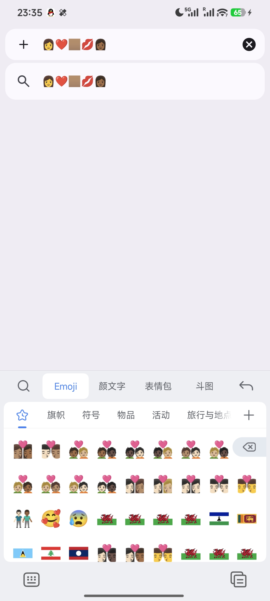

# SougouEmojiFixer

<div align="center">
  
</div>

为搜狗输入法小米版补全并统一 Unicode Emoji 的 LSPosed 模块。

搜狗自带表情包的 Unicode 覆盖不全、风格不统一（符号、旗帜等用系统字体），本模块用完整且风格统一的 **Noto Emoji** 替换搜狗的表情分组，并支持对表情分组进行排序管理。

## 功能特性

- **补全 Unicode Emoji**：从 Unicode 官方 `emoji-test.txt` 拉取数据，支持 Emoji 11.0 ~ 17.0（默认最新稳定版）。
- **统一风格**：所有表情（含旗帜、符号、肤色变体、ZWJ 组合、双肤色组合）统一使用 Noto Emoji 风格。
- **按系统支持过滤**：自动检测当前系统字库缺失的表情并跳过；也可选择"保留系统缺字"（强行全部安装）。
- **肤色合并**：把 5 种肤色变体合并成一条入口，通过搜狗自带的选择器切换；完整双肤色矩阵（如 👩❤️👩）自动生成 5 个"固定第二人称肤色"父条目。
- **可选资格形式**：可包含 `minimally-qualified` / `unqualified` 序列。
- **图片源可选**：GitHub 源站或 jsDelivr 镜像。
- **分组排序管理**：拖拽 / 箭头调整分组顺序（列表越靠上，在输入法表情栏越靠前），并写入搜狗包目录的排序值；搜狗自生成的"组合"包（ID 2）也纳入排序管理（仅排序，不补齐）。
- **自动重载**：安装 / 排序完成后自动结束搜狗进程，下次启动即生效，无需重启手机。

## 工作原理

搜狗的表情分组存储在数据目录的 `sogou/emojipackage/` 下，目录名为 `{分组ID}_{排序值}`，排序值越大在表情栏越靠前。

模块流程：

1. 从 Unicode 官方下载指定版本的 `emoji-test.txt`。
2. 解析出全部分组与序列，按系统字库过滤、合并肤色变体。
3. 从 Noto Emoji 下载对应 PNG，归一化为 64px 后写入分组的 `emoji/` 目录。
4. 替换搜狗内置表情分组（ID 3-23），生成新的 `info.xml` / `version.json`。
5. 按当前排序把各分组目录重命名为 `{ID}_{排序值}`。
6. 结束搜狗进程使其重新加载。

> 本模块只修改搜狗输入法自己的数据目录，不触碰系统，卸载模块后搜狗表情恢复原样（可在模块内重新安装/清理）。

## 环境要求

- Android 8.0（API 26）及以上，已 root
- [LSPosed](https://github.com/JingMatrix/LSPosed) 已安装
- 搜狗输入法**小米版**（`com.sohu.inputmethod.sogou.xiaomi`）
- 搜狗输入法已设为默认输入法，并**至少打开过一次 Emoji 面板**（用于生成 `emojipackage` 目录）

## 安装与使用

1. 构建或下载 APK，在 LSPosed 中启用模块并勾选作用域为 **搜狗输入法**。
2. 重启或结束搜狗进程使模块生效。
3. 打开模块 App → 首页选择 Unicode 版本 → 点击「安装 / 重新安装 Emoji」。
4. 安装完成后搜狗会自动重载，新表情即生效。
5. 「排序」页可拖拽调整分组顺序，点击「保存配置」应用；搜狗自带的"组合"包也可在此排序。

## 构建

```bash
./gradlew :app:assembleDebug
```

产物位于 `app/build/outputs/apk/debug/app-debug.apk`。

## 说明

- 支持版本以 Unicode 官方 `emoji-test.txt` 为准，安装时校验目录版本与所选版本一致。
- "组合"包（ID 2）是搜狗自动生成的数据，模块仅做排序管理，不做任何下载 / 补齐。
- 首次使用需确保搜狗数据目录存在（打开一次 Emoji 面板）。

## 已知问题

- **部分输入环境的拆分显示**：部分输入环境（如 QQ、部分 Web 输入框）中，表情可能无法按预期组合，出现"拆分"显示的情况（例如肤色变体与主表情被拆开），目前仍在研究优化：

  

  

## 未来发展

- **支持更多搜狗版本**：初步研究显示，搜狗虽然存在许多系统定制版，但各定制版与官方版的表情包补全方式基本一致，模块计划逐步适配其他系统定制版乃至官方版（`com.sohu.inputmethod.sogou`）。如果你愿意，欢迎加入作为项目的测试员，反馈你所用搜狗版本的表现。

## 常见疑问

- **"做这个不如直接用 Gboard。"**

  Gboard 的中文输入体验很一般，多数国内用户并不习惯；而国产输入法在 Emoji 方面又普遍是短板。本项目的目的，就是在**保全中文输入体验**的同时，也能用上**完整的 Emoji**。如果你觉得 Gboard 好用，尽管去用——每个人都有各自的偏好，但你没有权利去干涉他人的选择。

- **"输入隐私问题怎么办？"**

  输入法本身就有隐私方面的顾虑。如果你在意，可以自行寻找对应的隐私屏蔽 / 离线方案来解决；或者回到上面的说法——选择适合自己的即可。

## 许可证

[GPL-3.0](LICENSE) © 2026 250king

## 免责声明

本项目仅供学习与技术研究使用。请勿将其用于任何违反软件许可协议或当地法律法规的用途。使用本模块造成的任何后果由使用者自行承担。


---

## Fork 功能：Noto ZIP 缓存 / 离线导入

本 Fork 将「数千个网络请求逐张下载 PNG」替换为「下载一次 Noto Emoji v2.051 ZIP → 仅提取所需 PNG → 安装」，并保留上游的 Unicode 词条解析、分组管理、肤色支持及 LSPosed Hook。

- **自动下载**：单次获取 [googlefonts/noto-emoji v2.051](https://github.com/googlefonts/noto-emoji/tree/v2.051) 官方源码 ZIP；服务器支持 Range 时可断点续传。
- **本地导入**：首页点击「导入本地 Noto Emoji ZIP」，支持官方源码 ZIP（可包含前缀目录），或已经裁剪的 PNG ZIP。
- **缓存复用**：导入或下载后，模块把需要的 PNG（包括旗帜）重新打包成精简 ZIP，存入自己的私有目录。下一次安装无需下载。
- **数据隔离**：ZIP 保存在模块 `/data/user/0/com.scluzlep.misougoemoji/files/noto-archive/`。搜狗进程通过 Android FileProvider 临时读取，不需要复制 ZIP 到搜狗目录。
- **安装阶段**：搜狗自己的 `files/sogou/.unicode-staging` 仍会写入转换为 64px 的 PNG 和分组信息；全部验证后才移动到 `emojipackage`。这是搜狗现有分组目录的必要工作区。

**注意：** 本 Fork 使用独立包名 `com.scluzlep.misougoemoji`，可与上游的 `com.king250.sougou` 共存，但为防重复 Hook，**请先在 LSPosed 禁用上游模块的作用域**，只启用此 Fork 的作用域（搜狗输入法小米版）。开发版本仍需备份重要的输入法数据后再试用。

官方 ZIP 地址（也可在浏览器下载后导入）：

```text
https://codeload.github.com/googlefonts/noto-emoji/zip/refs/tags/v2.051
```

### GitHub Actions 和 Release

工作流 `.github/workflows/android-release.yml`：
- Push / PR / 手动运行：构建 Debug 签名 APK，并在 Actions **Artifacts** 上传 APK 和 SHA256SUMS。
- 推送 `v*` 标签：构建 APK，并自动创建 GitHub **Release**。
- 未配置签名密钥时：非标签构建只产生 Debug Artifact；推送 Release 标签会明确失败，绝不把 Debug APK 误当正式发布。
- 正式版建议配置四个 Repository Secrets：`SIGNING_STORE_BASE64`、`ANDROID_KEYSTORE_PASSWORD`、`ANDROID_KEY_ALIAS`、`ANDROID_KEY_PASSWORD`。

```bash
git tag v1.1.0-zip.1
git push origin v1.1.0-zip.1
```

许可证保持上游 GPL-3.0，保留原作者版权。


### ZIP 读取权限修复 (v1.1.0-zip.2)

Android 17 上搜狗输入法使用动态注册的广播接收器读取安装指令时，广播附带的 `FLAG_GRANT_READ_URI_PERMISSION` 可能不能直接授予读取权限，导致 `Permission Denial ... FileProvider ... not exported`。

此版本在广播发送之前由模块主动执行 `Context.grantUriPermission(TARGET_PACKAGE, archiveUri, FLAG_GRANT_READ_URI_PERMISSION)`，仅向搜狗包授予临时只读权限；任务完成或出错收到状态回执后撤销。FileProvider **继续保持 `android:exported="false"`**，无需打开数据目录或赋予更广泛权限。

已缓存的 Noto ZIP 仍位于模块自己的私有目录；升级 APK 后直接再次点击安装即可，无须重新下载。
